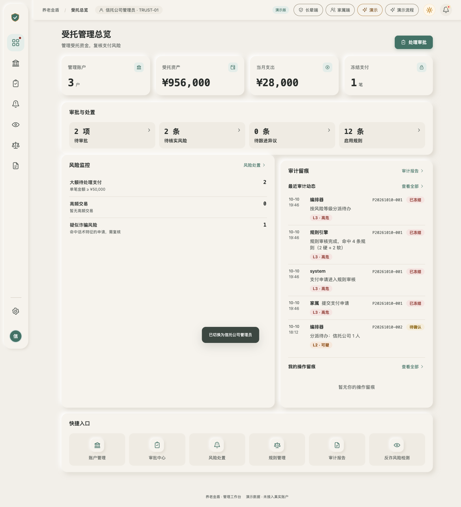
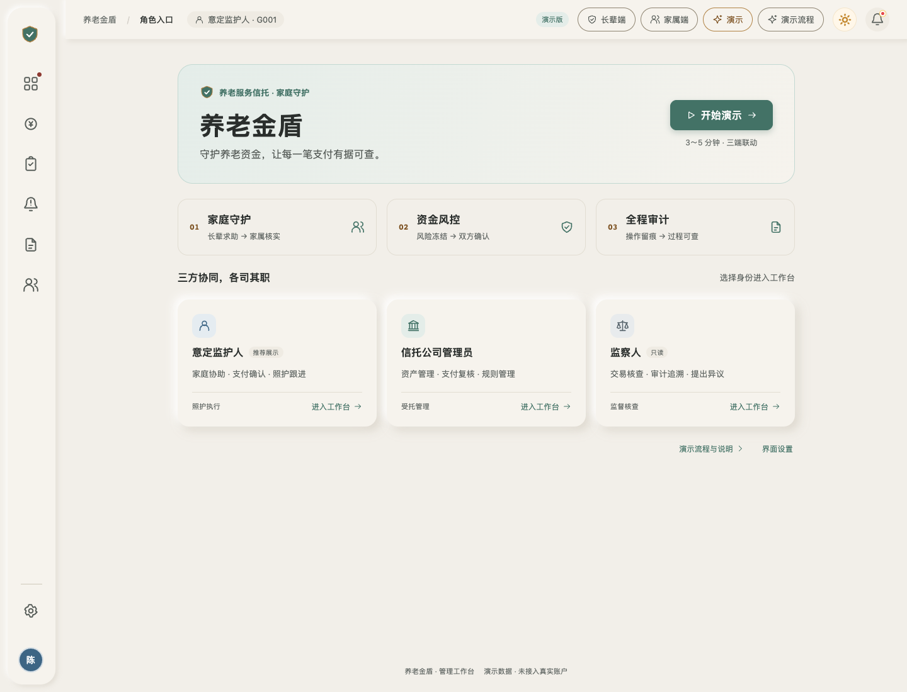
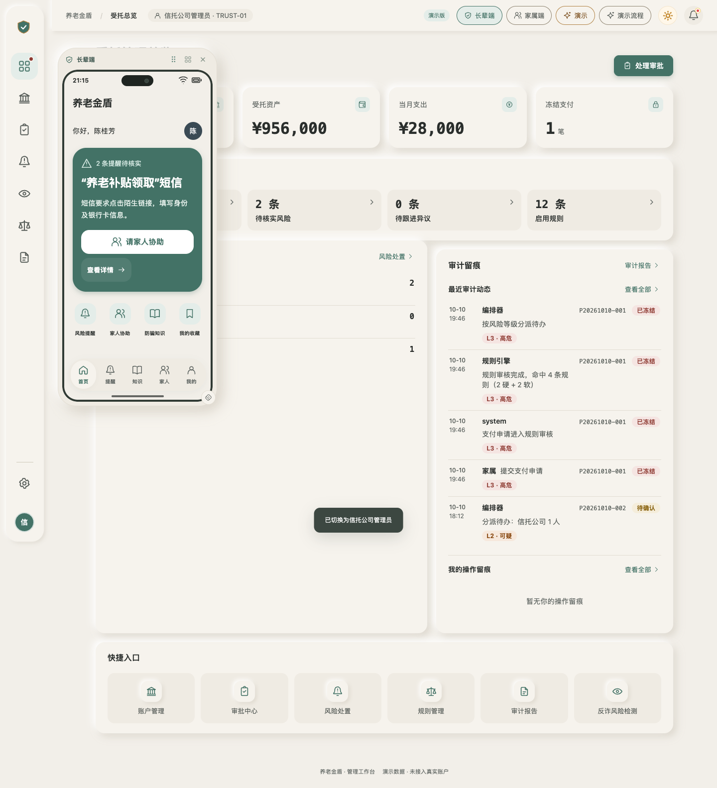

# 养老金盾（养老防骗管理演示）

面向老年人及其家属的养老资金防骗管理前端演示，使用 HTML、CSS 和原生 JavaScript 实现。项目包含信托公司管理员、家属和长辈端等多角色界面，演示受托资金管理、支付风险复核、审批处置和长辈端浮窗联动。

## 功能

- 多角色入口：信托公司管理员、家属、长辈端
- 受托资金总览与管理账户
- 模拟支付审批与风险处置流程
- 长辈端手机浮窗与家属端联动
- 本机操作留痕（localStorage）

## 技术栈

- HTML
- CSS
- 原生 JavaScript
- localStorage（演示数据）

没有真实 Python 后端、数据库、模型 API 或 RAG；0.85 反诈评分与特征标签是预置演示结果，不是真实模型评测。

## 本地运行

在仓库根目录启动静态服务：

```bash
cd UI-NewRawerd
python3 -m http.server 8000
```

打开 `http://127.0.0.1:8000/`。也可以用 VS Code 的 Live Server 打开 `UI-NewRawerd/index.html`。

## 截图







## 目录结构

```text
UI-NewRawerd/   页面、样式、脚本与模拟数据
docs/           README 截图
```

## 作者

李国龙、陆俊豪共同制作、共同完成。

## 说明

账号、审批、支付和收入均为模拟，不产生真实扣款或结算；数据保存在当前浏览器，不跨设备同步。项目为课程/演示用途，不代表真实反诈效果或生产系统。
